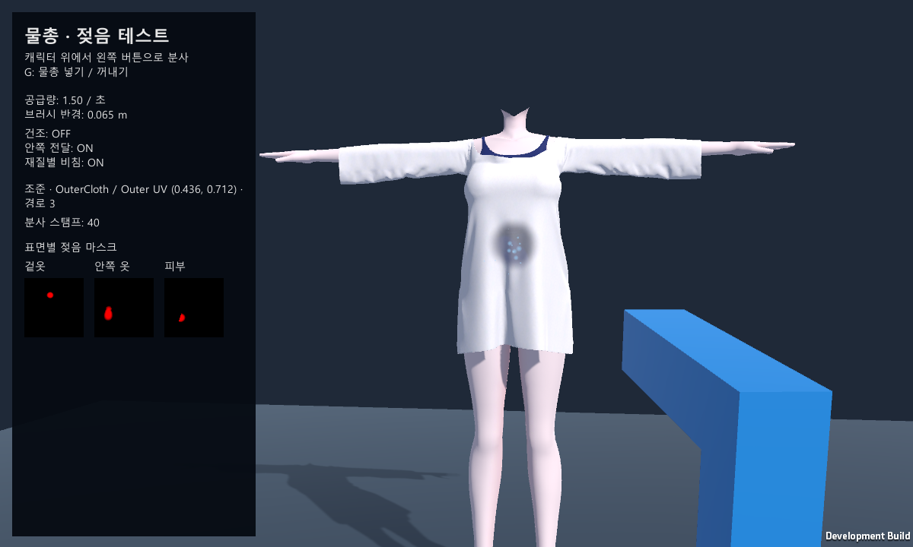

# Warudo Wetness System

물총으로 캐릭터의 옷과 피부를 적시는 Warudo 플러그인입니다. 젖은 부위의 색·광택·비침이 변하고 시간이 지나면 건조됩니다. 움직이는 스킨 메쉬의 삼각형과 UV로 적중 부위를 계산하며, 겉옷에서 안쪽 옷과 피부로 물을 전달합니다.

Unity 테스트 씬과 Warudo 빌드 설정을 포함합니다. **Unity 테스트와 모드 빌드에는 Warudo 설치가 필요하지 않습니다.**

현재 WaterGun 버전은 **0.6.7**입니다. 새 에셋·표면의 기본값은 젖은 불투명도 0.1, 광택 증가량 0.8, 초당 공급량 3, 브러시 반경 0.1m, 건조 시간 10초입니다. Unity 데모도 이 값으로 시작합니다. 기존 Warudo 씬에 저장된 값은 업데이트 시 유지됩니다.

## 시작하기

1. Windows에서 저장소 전체를 ZIP으로 내려받아 압축을 풀거나 Git으로 복제합니다. Unity Hub에서 `Assets`, `Packages`, `ProjectSettings`가 들어 있는 최상위 폴더를 추가합니다.
2. **Unity 2021.3.45f2**로 프로젝트를 엽니다. 최초 패키지 복원에는 Git과 인터넷 연결이 필요합니다.
3. 패키지 복원과 컴파일을 기다립니다. Built-in Render Pipeline / .NET Framework 설정을 유지합니다. 빌드 경로는 현재 프로젝트 위치에 맞춰 자동 설정됩니다.
4. `Portfolio > Open Interactive Demo Scene`으로 `Assets/Demo/WetnessDemo.unity`를 열고 **Play**를 누릅니다.
5. **Game 창을 클릭**하고 캐릭터를 향해 **마우스 왼쪽 버튼**을 누르면 분사됩니다. **G**로 물총을 넣고 꺼냅니다.

정보 패널에는 조준·분사 상태와 현재 설정이 표시됩니다. 패널 아래의 마스크에는 세 표면의 젖음 상태가 표시됩니다. 설정은 Inspector에서 조절합니다. Game 창은 1200×720 또는 16:9를 권장합니다.

Unity 데모 씬에서도 기능을 확인할 수 있습니다. **카메라를 움직이며 여러 각도에서 확인하거나 파라미터를 조절하려면 Warudo에서 테스트하는 것을 권장합니다.**

프로젝트를 열면 `Packages/manifest.json`에 지정된 버전의 Warudo SDK가 자동으로 설치됩니다. SDK를 따로 설치하거나 자산을 빈 프로젝트로 옮길 필요는 없습니다. Unity Console에 컴파일 오류가 없는지 확인한 뒤 진행합니다. Warudo에서 실행하려면 Warudo를 별도로 설치해야 합니다.

## Warudo로 가져가기

### 제공 파일로 빠르게 테스트하기

직접 빌드하지 않고 사용할 수 있는 플러그인·캐릭터·씬을 `WarudoDemo` 폴더에 포함했습니다.

| 제공 파일 | 데이터 폴더 안의 복사 위치 |
|---|---|
| [WaterGun.warudo](WarudoDemo/WaterGun.warudo) | `Plugins/WaterGun.warudo` |
| [WetnessDemoCharacter.warudo](WarudoDemo/WetnessDemoCharacter.warudo) | `Characters/WetnessDemoCharacter.warudo` |
| [ShoulderCorrection.warudo](WarudoDemo/ShoulderCorrection.warudo) | `Plugins/ShoulderCorrection.warudo` |

Warudo의 **`Menu > Open Data Folder`**로 데이터 폴더를 연 뒤 Warudo를 종료하고 위 파일을 복사합니다. 다시 실행한 뒤 [warudo_sww_demo.json](WarudoDemo/warudo_sww_demo.json)을 씬으로 가져오면 카메라·캐릭터·물총과 표면 설정을 불러와 빠르게 테스트할 수 있습니다. 캐릭터가 표시되면 렌더 창에서 옷을 향해 마우스 왼쪽 버튼을 누릅니다.

첨부 씬은 젖음 테스트용입니다. 어깨 보정도 사용하려면 **자동 어깨 보정** 에셋을 추가하고 같은 캐릭터를 대상으로 선택합니다.

### 빌드와 파일 설치

1. Unity에서 Play 모드를 종료하고 **`Portfolio > Build All Mods`**를 실행합니다.
2. 빌드가 끝나면 Console의 `[Portfolio] MOD BUILD PASSED 0`, `1` 메시지와 아래 두 파일을 확인합니다. `Exports`는 이 Unity 프로젝트의 최상위 폴더에 생성됩니다.
3. Warudo 편집 창의 **`Menu > Open Data Folder`**로 데이터 폴더(`StreamingAssets`)를 엽니다. 이 메뉴를 사용하면 설치 위치에 관계없이 복사할 폴더를 찾을 수 있습니다. 자세한 내용은 [공식 데이터 폴더 안내](https://docs.warudo.app/docs/tutorials/data-folder)를 참고합니다.
4. `.warudo` 파일 각각을 아래 폴더에 복사합니다.

| 생성 파일 | 데이터 폴더 안의 복사 위치 | 역할 |
|---|---|---|
| `Exports/WaterGun/WaterGun.warudo` | `Plugins/WaterGun.warudo` | 물총·젖음 플러그인 |
| `Exports/WetnessDemoCharacter/WetnessDemoCharacter.warudo` | `Characters/WetnessDemoCharacter.warudo` | 첫 테스트에 사용할 캐릭터 |

파일 복사 후 Warudo를 다시 실행합니다. 기존 패키지를 교체할 때에는 먼저 Warudo를 종료하고 파일을 덮어씁니다.

### 캐릭터와 젖음 표면 연결

1. Warudo의 **`Add Asset`** 메뉴에서 **Character** 에셋을 추가하거나 기존 Character 에셋을 선택합니다. **`Source`**에서 `WetnessDemoCharacter`를 선택하고 모델이 로드될 때까지 기다립니다. [공식 Character 안내](https://docs.warudo.app/docs/assets/character)에서 기본 불러오기 절차를 확인할 수 있습니다.
2. **`Add Asset`** 메뉴에서 **WaterGun** 에셋을 추가합니다. WaterGun의 **`대상 캐릭터`**에 앞에서 불러온 Character 에셋을 지정합니다. 첫 테스트에는 포함된 데모 캐릭터를 사용합니다. 다른 VRM 모델은 셰이더가 젖음 기능을 지원하지 않을 수 있습니다.
3. **`메쉬·머티리얼 목록`**이 표시될 때까지 기다립니다. 목록에서 `OuterCloth`, `InnerCloth`, `Skin` 아래에 표시된 **`# 번호`**를 각각 확인합니다. 이 번호는 전체 표면 목록의 번호이며, 옆에 표시된 `슬롯 0` 등의 머티리얼 슬롯 번호와 다릅니다.
4. `OuterCloth`의 `# 번호`를 **`등록할 표면 번호 (목록의 # 번호)`**에 입력하고 **`번호의 표면 등록`**을 누릅니다. `InnerCloth`, `Skin`도 각 표면의 `# 번호`로 등록합니다.
5. **`표면별 설정`**을 펼치고 다음 표처럼 설정합니다. `적용할 메쉬 / 머티리얼`에서 각 항목이 의도한 표면을 가리키는지도 확인합니다.

| 표면 | 옷 레이어 순서 | 젖음 사용 | 판정 전용 차단 | 안쪽으로 전달 허용 | 이 표면을 적신 후 종료 | 비침 허용 |
|---|---:|---|---|---|---|---|
| `OuterCloth` | 0 | ON | OFF | ON | OFF | ON |
| `InnerCloth` | 1 | ON | OFF | ON | OFF | ON |
| `Skin` | 2 | ON | OFF | OFF | ON | OFF |

6. WaterGun의 **`물총 사용`**, **`안쪽 표면 전달`**, **`진단 HUD`**를 켭니다. **`초당 공급량`**은 0보다 크게 설정합니다. 첫 테스트에는 기본 공급량 `3`, 브러시 반경 `0.1m`, 전달 깊이 `0.15m`를 사용합니다. 건조를 확인하려면 전체 **`건조 사용`**과 각 표면의 **`건조 사용`**도 켭니다.

### 분사와 결과 확인

1. Warudo의 Camera 에셋으로 캐릭터 앞쪽이 렌더 창에 보이도록 구도를 맞춥니다. 물총 사거리는 8m이므로 캐릭터를 너무 멀리 두지 않습니다.
2. 설정 편집 창이 아닌 **캐릭터가 보이는 렌더 창**을 클릭합니다. **G**를 한 번 눌러 총을 꺼내거나 설정창의 **`물총 꺼냄`**을 켭니다.
3. HUD 영역을 피해서 옷으로 덮인 배 부분을 조준하고 마우스 왼쪽 버튼을 누릅니다. HUD의 적중 표면·UV·공급 횟수와 겉옷의 젖은 자국을 확인합니다. 안쪽 전달은 해당 위치에 안쪽 메쉬가 있고 전달 깊이 안에 있을 때 적용됩니다.
4. 버튼을 놓고 기다려 젖음이 줄어드는지 확인합니다. 겉옷과 안쪽 옷의 비침은 각 항목의 **`완전히 젖은 불투명도`**로 조절합니다. 피부는 비침을 꺼 둡니다.
5. 같은 조건으로 다시 테스트하려면 **`다시 연결 (젖음 초기화)`**를 누릅니다. 표면의 외형과 건조 설정을 바꿀 때에는 이미 등록된 **`표면별 설정`**을 수정합니다. `등록 기본값`은 이후 새로 등록하는 항목에만 복사됩니다.

빌드 경로는 프로젝트 위치에 맞춰 자동으로 갱신됩니다. 모드 이름·버전·아이콘은 유지되며, 전체 빌드 후에는 이전에 선택한 모드로 돌아갑니다. 개별 모드를 빌드하려면 `Warudo > Switch Active Mod...`에서 선택한 뒤 `Warudo > Build Mod`를 실행합니다. 경로를 다시 설정할 때에는 `Portfolio > Configure Mod Exports`를 사용합니다.

모드 빌드 결과는 `Exports`, Unity 실행 파일과 검사 결과는 `Artifacts`에 저장됩니다.

## 주요 구현

- **조준과 실제 적중:** 화면 조준으로 적중과 전달 경로를 결정하고, 근거리에서 물총이 뒤로 꺾이지 않도록 자세와 위치를 보정합니다.
- **움직이는 메쉬:** 현재 자세로 변형된 스킨 메쉬를 Bake하고 BVH 경계를 갱신합니다. 같은 프레임의 판정에는 이 결과를 재사용합니다.
- **젖음 상태:** 월드 공간 브러시를 UV 마스크로 변환하고 렌더러·머티리얼 슬롯별 RenderTexture에 누적합니다.
- **겹친 표면:** 겉옷에서 안쪽 옷과 몸체로 전달하며 표면별 건조·외형·전달·종료 설정을 적용합니다.
- **비침과 그림자:** 불투명 원본과 투명 보조 렌더러를 분리해 건조 영역의 깊이와 그림자를 유지합니다.

## Unity에서 설정과 검사

물총의 공급량·브러시 반경·건조·안쪽 전달·건조 시간은 `WetnessDemo`와 `WaterGunDriver`의 Inspector에서 조절합니다. 양쪽 값을 변경하면 `WetnessDemo`의 설정이 우선합니다. **Rate는 초당 젖음 공급량**입니다. 0이면 공급이 멈추며, 물줄기 굵기와 물 튀김 입자 수에는 영향을 주지 않습니다. 젖음을 초기화하려면 `WetnessDemo` 컴포넌트의 컨텍스트 메뉴에서 `Reset Wetness`를 실행합니다.

외형의 초기값은 원본 머티리얼에서 가져옵니다. 재생 중에는 캐릭터 메쉬의 Renderer에 연결된 `WaterGun runtime / ...` 재질에서 어두워짐·광택·불투명도·비침 허용을 조절합니다. `WetnessDemo.Translucency`로 전체 비침을 켜고 끕니다. 재생 중 변경한 값은 종료하면 사라집니다. 설정을 유지하려면 재생을 멈추고 원본 재질에 저장합니다. 젖음 마스크와 입력은 데모에서 관리합니다.

| Unity 메뉴 | 확인 내용 / 출력 |
|---|---|
| `Portfolio > Run Validation` | 슬롯·전달·비침·리소스 해제 검사 → `Artifacts/validation.json` |
| `Portfolio > Verify Interactive Demo Scene` | 열린 데모 씬의 스크립트·연결 참조 검사 |
| `Portfolio > Build Interactive Demo` | Windows 실행 파일 → `Artifacts/InteractiveDemo` |
| `Portfolio > Build Benchmark Player` | 자동 성능 계측 Player. 씬: `Assets/WaterGunValidation/WaterGunPlayerProfile.unity` |

## 모캡·어깨 보정과 함께 사용하기

**Warudo 모캡, 자동 어깨 보정, WaterGun은 함께 사용할 수 있습니다.** 모캡 연동은 **RhyLive로 테스트했으며, 다른 모캡 입력은 아직 확인하지 않았습니다.** 연결 방법은 [Warudo의 RhyLive 안내](https://docs.warudo.app/docs/mocap/rhylive)를 참고합니다.

자동 어깨 보정의 **`팔 올리기 테스트 (모캡 없이)`와 물총의 동시 사용은 지원하지 않습니다.** 물총으로 젖음을 확인할 때에는 해당 테스트를 끄고 일반 애니메이션 또는 모캡 입력을 사용합니다.

## 문제가 발생할 때

젖음이나 비침이 예상과 다르면 **`표면별 설정`의 `옷 레이어 순서 (바깥→안쪽 증가)`를 가장 먼저 확인합니다.** 겉옷 → 안쪽 옷 → 피부 순서로 값이 증가하도록 설정해야 합니다.

| 증상 | 확인할 내용 |
|---|---|
| Unity에 Portfolio 메뉴가 없거나 빌드가 시작되지 않습니다. | 패키지 복원 완료와 Console의 첫 컴파일 오류를 확인합니다. Git 설치 후 Unity를 다시 열어야 할 수 있습니다. 경로 오류라면 `Portfolio > Configure Mod Exports`로 다시 설정합니다. |
| SDK 예외 로그가 표시됩니다. | Console의 첫 오류와 두 빌드 성공 메시지, 출력 파일을 확인합니다. 성공 메시지가 없거나 빌드가 중단되면 실패로 처리합니다. |
| Warudo에 WaterGun이 없습니다. | `.warudo` 파일이 실제 데이터 폴더의 `Plugins`에 있는지 확인하고 Warudo를 재시작합니다. |
| 캐릭터가 Source 목록에 없습니다. | 캐릭터 파일이 데이터 폴더의 `Characters`에 있는지 확인하고 Warudo를 재시작합니다. |
| 물은 보이지만 옷이 젖지 않습니다. | 대상 캐릭터, `# 번호`로 등록한 표면, 상태의 연결 오류, 지원 셰이더 여부, `젖음 사용`, 공급량을 확인합니다. |
| 안쪽 전달 또는 건조가 적용되지 않습니다. | 레이어 순서·전달 허용·종료 옵션·전달 깊이와 전체/표면별 건조 사용을 확인합니다. |
| G 또는 클릭에 반응하지 않습니다. | 렌더 창에 포커스가 있는지, HUD 밖을 조준했는지, 물총 사용과 꺼냄이 켜져 있는지 확인합니다. |
